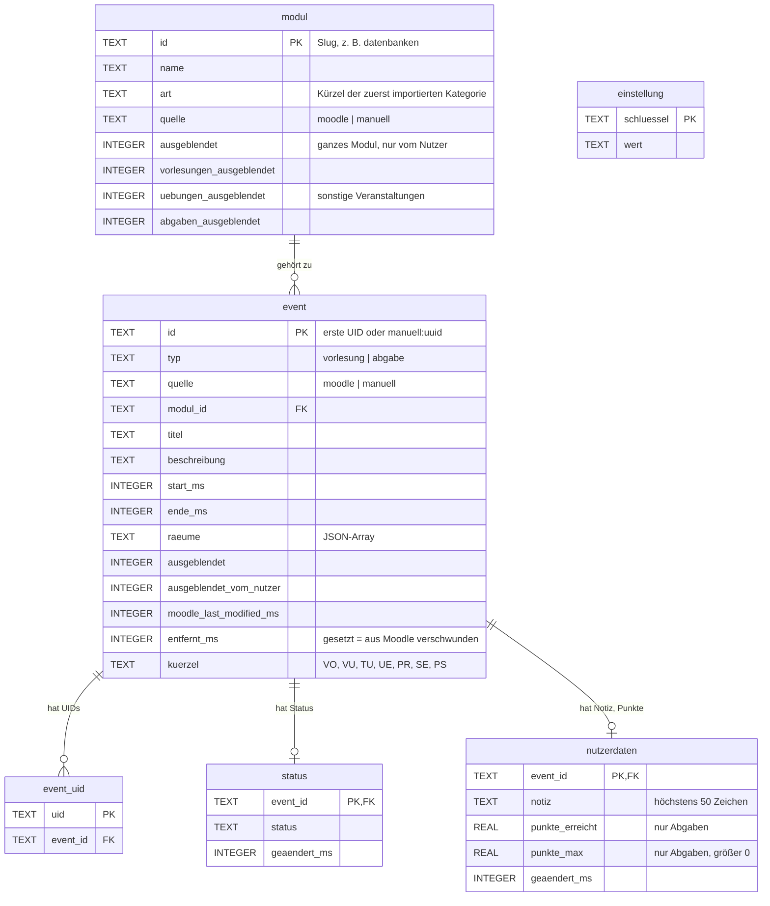
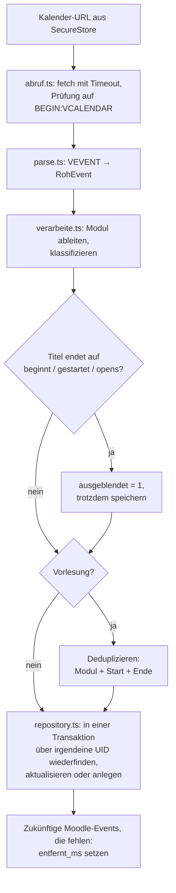
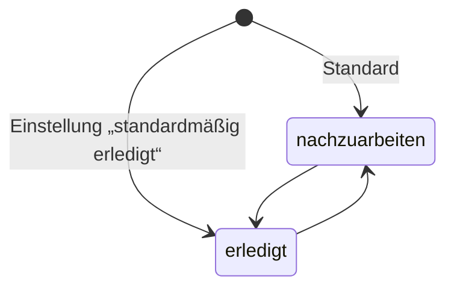
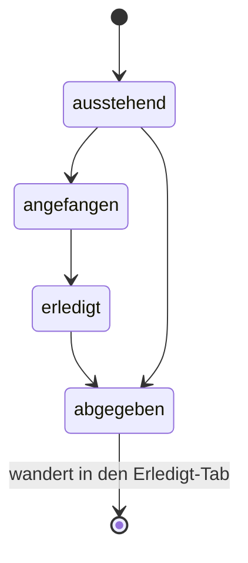

# Datenmodell

Quelle der Wahrheit für das Schema ist [`src/db/schema.sql`](../src/db/schema.sql) (aktueller Stand, Version 4; bestehende Installationen werden über [`src/db/migrationen/`](../src/db/migrationen/) aktualisiert), für Typen und Kernregeln [`src/model/types.ts`](../src/model/types.ts).

## Tabellen

- Der Nutzerstatus liegt in `status`, Notiz und Punkte in `nutzerdaten`. Ein Import fasst beide Tabellen nie an.
- Punkte sind Zahlen, damit sie sich später auswerten lassen (z. B. Summe oder Anteil pro Modul).
- Fehlt eine Zeile in `status`, gilt der Standard: Vorlesung → Einstellung (Default `nachzuarbeiten`), Abgabe → `ausstehend`.
- `ausgeblendet` setzt der Import für Öffnungs-Marker. Hat der Nutzer selbst ein- oder ausgeblendet (`ausgeblendet_vom_nutzer = 1`), überschreibt der Import das nicht mehr.
- `einstellung` enthält `vorlesung_standard`, `nur_abgaben`, `startdatum_ms` (Montag der Einrichtungswoche; Moodle-Events davor werden nicht angezeigt), `letzter_abruf_ms`, `letzter_abruf_fehler` und `beispieldaten`.
- Die Moodle-Kalender-URL liegt **nicht** in der Datenbank, sondern nur im `expo-secure-store`.

## Import-Ablauf

## Status

### Vorlesung

Erscheint am Tag der Vorlesung unter „Heute“ (unabhängig vom Status), danach mit Status `nachzuarbeiten` unter „Nachzuarbeiten“ oder mit `erledigt` im Erledigt-Tab.

Andere Veranstaltungen (Typ `vorlesung`, aber laut Titel oder Kürzel Übung, Tutorium usw., siehe `istVorlesung`; in der App „Übung“) haben keinen Status: Sie erscheinen nur am selben Tag unter „Heute“.

Pro Modul lassen sich Vorlesungen, Übungen und Abgaben einzeln ausblenden (`modul.*_ausgeblendet`), zusätzlich zum ganzen Modul (`modul.ausgeblendet`).

### Abgabe

`erledigt` = fertig bearbeitet, aber noch nicht abgegeben (z. B. Warten auf Abgabepartner).
